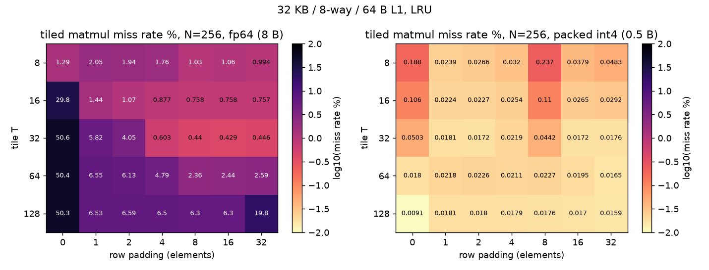

# cache-tiling-sim

[](https://github.com/YeeDEA/cache-tiling-sim/actions/workflows/ci.yml)
[](LICENSE)

A small set-associative **cache simulator** (C++14, no dependencies) that replays the memory
access patterns of matrix multiplication and classifies every miss as **compulsory / capacity /
conflict**. It exists to answer one question with numbers: *why does loop tiling work, and when
does it silently fail?*

A companion **CUDA SGEMM suite** (`cuda/`) measures the same memory-hierarchy progression on real
GPU hardware — from global-memory naive, to shared-memory tiling, to **2D register tiling**,
benchmarked directly against **cuBLAS**.

## Build and run

```bash
make            # builds ./cachesim (Linux/macOS g++)
make test       # selftest (3C, LRU/FIFO/PLRU/random, write-back) + golden --trace tests
./cachesim --workload tiled --n 256 --tile 32 --pad 8
bash scripts/run_experiments.sh   # reproduces the CPU tables below
bash scripts/run_elem.sh
make policy     # replacement-policy comparison (table below)
make heatmap    # docs/results/heatmap.csv + docs/heatmap.png (needs matplotlib)
```

CI (GitHub Actions, Ubuntu `g++`) builds with `-Werror`, runs `make test`, re-runs the selftest under
`-DNDEBUG`, and regenerates every CPU table in this README; the raw outputs are in [`docs/results/`](docs/results/).

On Windows PowerShell (e.g., MinGW `g++`):

```powershell
g++ -O2 -static -std=c++14 -Wall -Wextra -o cachesim.exe src/cachesim.cpp
.\cachesim.exe --selftest
.\scripts\run_experiments.ps1
.\scripts\run_elem.ps1
```

Options: `--workload naive|ikj|tiled`, `--n`, `--tile`, `--pad` (row padding, in elements),
`--elem` (bytes per element: `8/4/2/1`), `--bits` (`64/32/16/8/4`, where `4` = packed `int4`),
`--size/--assoc/--block` (cache geometry), `--hit/--penalty` (AMAT inputs),
`--trace FILE` (replay `R 0x..` / `W 0x..` lines), `--policy lru|fifo|random|plru`.

## Model

- Write-back, write-allocate, single level. Default: 32 KB, 8-way, 64 B blocks (64 sets), true LRU.
  `--policy` selects FIFO, random (xorshift, fixed seed, so runs are reproducible) or tree pseudo-LRU.
- Miss classification: *compulsory* = first touch of a block; otherwise *conflict* if a
  fully-associative LRU cache of the same capacity would have hit, else *capacity*. The shadow cache
  is LRU for every policy, so with non-LRU policies "conflict" also absorbs policy-induced misses.
- Matrices are row-major, `N = 256`, 8 B elements unless `--elem` or `--bits` says otherwise.
- `naive` is ijk with the accumulator in a register; `ikj` is the loop-interchanged version;
  `tiled` is blocked ijk (C partial sums are loaded and stored once per k-tile).
- AMAT = hit time + miss rate x penalty, with 1 and 100 cycles.

## CPU Cache Results (N = 256, fp64, 32 KB / 8-way / 64 B)

| workload | tile | pad | misses | miss rate % | compulsory | capacity | conflict | writebacks | AMAT |
|---|---|---|---|---|---|---|---|---|---|
| naive | - | 0 | 16923648 | 50.3381 | 24576 | 2088960 | 14810112 | 65504 | 51.338 |
| naive | - | 8 | 2113536 | 6.2865 | 24576 | 2088960 | 0 | 8190 | 7.287 |
| ikj | - | 0 | 2113536 | 4.1938 | 24576 | 2088960 | 0 | 8160 | 5.194 |
| tiled | 8 | 0 | 486848 | 1.2897 | 24576 | 269824 | 192448 | 200605 | 2.290 |
| tiled | 16 | 0 | 10640384 | 29.8455 | 24576 | 138240 | 10477568 | 1048574 | 30.845 |
| tiled | 32 | 0 | 17498112 | 50.5682 | 24576 | 141568 | 17331968 | 524284 | 51.568 |
| tiled | 64 | 0 | 17174528 | 50.3966 | 24576 | 2138112 | 15011840 | 262136 | 51.397 |
| tiled | 32 | 8 | 152256 | 0.4400 | 24576 | 120624 | 7056 | 21058 | 1.440 |

### What the numbers show

1. **Tiling works, but only if the tile actually stays resident.** Best tiled configuration
   (tile 32, pad 8) has 111x fewer misses than the naive loop and AMAT drops from 51.3 to 1.44 cycles.
2. **Power-of-two strides are a trap.** With `N = 256` doubles a row is 2 KB = 32 blocks, so walking a
   column of B touches only 2 of the 64 sets. `naive, pad 0` is 87% conflict misses (14.8M of 16.9M),
   and tiles of 16 and 32 fail for the same reason even though a 32x32 double tile (8 KB) fits easily in
   a 32 KB cache. Capacity was never the problem.
3. **Padding the leading dimension fixes it.** Adding 8 elements per row removes the aliasing:
   conflict misses go from 14.8M to 0 for `naive`, and from 17.3M to 7k for `tiled, tile 32`.
4. **Tiling and loop interchange attack the same problem.** `ikj` (no tiling) already reaches
   2.1M misses because its inner loop has unit stride; tiling adds reuse on top of that.

### Element width (relevance to quantization)

Same experiment with `--bits` swept from `64` to `4` (`fp64 / fp32 / fp16 / int8 / packed int4`), `pad = 8` elements:

| bytes/elem | workload | tile | miss rate % | misses | AMAT |
|---|---|---|---|---|---|
| 8 (`fp64`) | naive | - | 6.2865 | 2113536 | 7.287 |
| 8 (`fp64`) | tiled | 32 | 0.4400 | 152256 | 1.440 |
| 8 (`fp64`) | tiled | 64 | 2.3574 | 803356 | 3.357 |
| 4 (`fp32`) | naive | - | 3.2415 | 1089792 | 4.242 |
| 4 (`fp32`) | tiled | 32 | 0.2282 | 78976 | 1.228 |
| 4 (`fp32`) | tiled | 64 | 0.1623 | 55296 | 1.162 |
| 2 (`fp16`) | naive | - | 1.6211 | 545024 | 2.621 |
| 2 (`fp16`) | tiled | 32 | 0.1385 | 47936 | 1.139 |
| 2 (`fp16`) | tiled | 64 | 0.0972 | 33125 | 1.097 |
| 1 (`int8`) | naive | - | 1.3692 | 460327 | 2.369 |
| 1 (`int8`) | tiled | 32 | 0.0585 | 20244 | 1.059 |
| 1 (`int8`) | tiled | 64 | 0.0425 | 14478 | 1.042 |
| 0.5 (`int4`) | naive | - | 8.4288 | 2833763 | 9.429 |
| 0.5 (`int4`) | tiled | 32 | 0.0442 | 15290 | 1.044 |
| 0.5 (`int4`) | tiled | 64 | 0.0227 | 7734 | 1.023 |

Narrower elements shrink the footprint: a `64x64` tile overflows L1 at 8 B (`2.357%` misses) but fits cleanly at `4 B`
and below (`0.162% -> 0.023%` at packed `int4`), so **the best tile size depends on the data type**. Notice also
that `pad = 8` elements is only `4 B` at `int4` (less than a 64 B cache block), so the 256 column blocks land unevenly across the sets (some sets get 9 blocks for 8 ways, which thrashes under LRU) and pushes `naive` to `8.429%` (`2.79M` conflict misses); padding by a full cache line (`--pad 128` = `64 B`) drops
`naive` `int4` misses down to `8,672` (`0.026%`, AMAT `1.026`), while `tiled 64` hits `7,734` (`0.023%`, AMAT `1.023`).

### Tile x padding map



At `fp64` the whole `pad = 0` column is black (29.8–50.6% for `T >= 16`): no tile size escapes the power-of-two
aliasing, and any padding of 4+ elements makes `T = 32` the clear winner. At packed `int4` everything is small,
but `pad = 8` (only 4 B) is visibly worse than its neighbours for `T = 8/16/32` — the same uneven-set effect as above.

### Is the int4 `pad 8` cliff an LRU artifact? (`make policy`)

Same `naive` access stream, `N = 256`, 32 KB / 8-way / 64 B, four replacement policies
(full output: [`docs/results/policy.md`](docs/results/policy.md)):

| data | pad | LRU miss % | FIFO miss % | random miss % | tree-PLRU miss % |
|---|---|---|---|---|---|
| fp64 | 0 | 50.34 | 50.34 | 50.42 | 50.34 |
| fp64 | 8 | **6.29** | 6.66 | 8.78 | 6.29 |
| int4 | 0 | 1.77 | 1.96 | **0.82** | 1.19 |
| int4 | 8 | 8.43 | 8.42 | **2.20** | 8.05 |
| int4 | 128 | 0.026 | 0.030 | 0.029 | **0.019** |

- **fp64 pad 0 is policy-independent.** Each B column maps to 2 sets, i.e. 256 blocks into 16 ways:
  the overflow is so large that no victim choice helps. That is a pure mapping (conflict) problem.
- **int4 pad 8 is mostly a policy problem.** Some sets receive 9 blocks for 8 ways and are swept
  cyclically. LRU and FIFO evict exactly the block that comes back next, so every access in that set
  misses; tree-PLRU only approximates LRU and barely helps (8.05%). Random replacement keeps a random
  subset resident and cuts misses **3.8x** (8.43% -> 2.20%).
- **Random is not "better" in general.** When the working set fits (fp64 pad 8), LRU is optimal for this
  pattern and random is worst (8.78%). LRU's failure mode is specifically a cyclic set just over capacity.
- Padding by a full line (`--pad 128`) beats every policy change, so fixing the layout is still the answer.

## GPU Companion (`cuda/`) — Measured on RTX 5050 Laptop GPU (`sm_120`)

`cuda/kernels.cuh` and `cuda/matmul.cu` extend the blocking experiment onto an actual GPU memory hierarchy
(Global DRAM -> L2 -> Shared Memory -> Registers), adding a **2D register-tiled SGEMM** kernel with transposed,
bank-conflict-padded `As` staging and benchmarking against **cuBLAS**.

Two ways to run:

```bash
cd cuda && make run        # nvcc + -lcublas (RTX 50-series needs CUDA Toolkit 12.8+)
cd cuda && make nvrtc      # zero-nvcc runner via PyTorch's NVRTC + Driver API (Windows, CUDA 13.0)
cd cuda && make nvrtc-test # unaligned boundary verification (N=129, 255 across all 5 kernels)
```

Measured with `run_nvrtc.py` (median of 10 runs, `NVIDIA GeForce RTX 5050 Laptop GPU, sm_120`, CUDA 13.0). Correctness is checked against PyTorch's FP32 cuBLAS result, so the cuBLAS FP32 row is the reference itself. Laptop boost clocks vary run to run, so treat the numbers as approximate.

### N = 2048 (A, B, C = 16 MB each)

| kernel | time (ms) | GFLOP/s | vs naive | % of cuBLAS (FP32) | max rel err |
|---|---|---|---|---|---|
| `naive (16x16)` | 28.072 | 612.0 | 1.00x | 11.9% | 0.00e+00 |
| `tiled T=16` (SMEM only) | 19.792 | 868.0 | 1.42x | 16.9% | 0.00e+00 |
| `tiled T=32` (SMEM only) | 23.004 | 746.8 | 1.22x | 14.5% | 0.00e+00 |
| `reg_tiled 64x64 (4x4/thread)` | 6.851 | 2507.5 | 4.10x | 48.8% | 0.00e+00 |
| `reg_tiled 128x128 (8x8/thread)` | **5.272** | **3258.8** | **5.32x** | **63.4%** | 0.00e+00 |
| `cuBLAS (FP32 SIMT)` | 3.342 | 5140.7 | 8.40x | 100.0% | (reference) |
| `cuBLAS (TF32 Tensor Core)` | 2.363 | 7269.9 | 11.88x | 141.4% | 5.25e-05 |

### N = 4096 (A, B, C = 64 MB each — exceeds L2 working set)

| kernel | time (ms) | GFLOP/s | vs naive | % of cuBLAS (FP32) | max rel err |
|---|---|---|---|---|---|
| `naive (16x16)` | 383.802 | 358.1 | 1.00x | 7.3% | 0.00e+00 |
| `tiled T=16` (SMEM only) | 211.805 | 648.9 | 1.81x | 13.2% | 0.00e+00 |
| `tiled T=32` (SMEM only) | 187.830 | 731.7 | 2.04x | 14.8% | 0.00e+00 |
| `reg_tiled 64x64 (4x4/thread)` | 58.276 | 2358.4 | 6.59x | 47.8% | 0.00e+00 |
| `reg_tiled 128x128 (8x8/thread)` | **38.206** | **3597.3** | **10.05x** | **72.9%** | 0.00e+00 |
| `cuBLAS (FP32 SIMT)` | 27.854 | 4934.3 | 13.78x | 100.0% | (reference) |
| `cuBLAS (TF32 Tensor Core)` | 15.407 | 8920.8 | 24.91x | 180.8% | 5.90e-05 |

Tables are run 3 of 3 back-to-back runs ([`docs/results/nvrtc_bench_run*.log`](docs/results/)); across the three runs
`reg_tiled 128x128` ranged 2795–3261 GFLOP/s at `N=2048` and 3570–3622 at `N=4096`, so N=2048 numbers vary by ~15%
on this laptop, N=4096 by ~1.5%. `make nvrtc-test` output: [`docs/results/nvrtc_selftest.log`](docs/results/nvrtc_selftest.log).
The `nvcc` path (`make run`) was not run for these numbers (no CUDA Toolkit on the measuring machine).

### What the GPU numbers show

1. **Shared-memory tiling alone still hits a memory wall.** `tiled T=16` reaches only 1.4x over naive at `N=2048`: cutting DRAM traffic helps, but each thread still issues two shared-memory reads (`As[ty][k]`, `Bs[k][tx]`) per FMA (0.25 FLOP/byte out of SMEM). At `N=2048`, `T=32` (1024 threads/block) is consistently slower than `T=16` in all three runs (`746.8` vs `868.0 GFLOP/s`), plausibly lower occupancy (not profiled); at `N=4096`, where DRAM traffic dominates, the larger tile wins (`731.7` vs `648.9`).
2. **Register tiling unlocks compute throughput.** Holding a 2D `TM x TN` accumulator tile in thread registers turns each `k`-step into an outer product (`regA[TM] x regB[TN]`). With `8+8` SMEM loads feeding `64` FMAs in `128x128 (8x8)`, SMEM read traffic per FLOP drops 8x, reaching **63.4% of cuBLAS FP32 SIMT at `N=2048`** and a **10.05x speedup over naive (72.9% of cuBLAS) at `N=4096`**.
3. **Bigger register tile wins at both sizes.** `128x128 (8x8)` beats `64x64 (4x4)` in all three runs, by ~1.3x at `N=2048` and ~1.5x at `N=4096`. Each thread does 4x more FMAs per SMEM load and each block reloads A/B half as often; the gain is larger at `N=4096`, where those reloads miss L2. (An earlier, unlogged run had shown `64x64` ahead at `N=2048`; it did not reproduce, so that claim was removed.)
4. **SIMT vs. Tensor Core precision.** Disabling TF32 isolates IEEE-754 FP32 SIMT throughput; enabling TF32 engages Blackwell Tensor Cores for another ~1.8x at `N=4096` (`8921 GFLOP/s`) at `5.90e-5` relative error. The custom kernels show `0.00e+00` error against cuBLAS FP32, i.e. bit-identical here; treat that as "same summation order on these inputs", not as a general guarantee.

## Connection to companion repositories

See [docs/DEEP_DIVE.md](docs/DEEP_DIVE.md) for line-by-line code walkthroughs, set-aliasing derivations, SMEM bank-conflict analysis, and full study notes bridging these repositories:

- **[`YeeDEA/mac-array-dv`](https://github.com/YeeDEA/mac-array-dv)** (SystemVerilog + UVM 1.2 output-stationary `4x4 / 8x8` INT8 MAC array, `57/57` regression, `12` SVA): Continues the pipeline-and-cache motivation noted in `mac-array-dv`'s README (originating from a 5-stage pipelined MIPS processor). Architecturally, an output-stationary PE array pins partial sums in PE accumulator registers just as `matmul_reg_tiled_impl` pins `acc[TM][TN]` in thread registers — shifting the bottleneck to external tile feeding (`cachesim`). Methodologically, `cuda/run_nvrtc.py --selftest` (`N=129, 255`) applies the same anti-vacuous-pass rule learned when auditing `mac-array-dv`'s `xsim dist` stimulus and assertion `A8`.
- **[`YeeDEA/quantcliff`](https://github.com/YeeDEA/quantcliff)** & **[`YeeDEA/jetson-orin-llm`](https://github.com/YeeDEA/jetson-orin-llm)** (Quantized LLM behavior on **RTX 5050 8 GB** & `INT4/NF4` edge deployment): In `quantcliff`, shrinking `Qwen3-4B` from `bf16` (`7822 MiB`, `5.9 tok/s`) to `Q8_0` (`5414 MiB`, `57.8 tok/s`) removes 8 GB VRAM spillover for a ~`10x` speedup with flat accuracy (`78%`), mirrored on `Llama-3.1-8B` (`7818 MiB` `8.1 tok/s` -> `Q4_K_M` `5648 MiB` `46.9 tok/s`). The `--bits` sweep here illustrates the same capacity-cliff mechanism one level down, inside a 32 KB L1 (an analogy, not the same cliff): `64x64` thrashes at `fp64` (`2.357%` misses) and drops cleanly to `0.0425%` (`int8`) and `0.0227%` (packed `int4`).

## Limitations

CPU simulator models a single cache level (write-back; LRU/FIFO/random/tree-PLRU) without hardware prefetching or TLB effects; absolute cycle counts depend on core microarchitecture, while 3C miss trends and stride aliasing hold generally. The simulator has not been cross-checked against `cachegrind` or real hardware counters.

## Questions this repo should let you answer

- Why does `naive, pad 0` have mostly conflict misses even though the working set fits?
- What changes in the 3C breakdown when you pad the rows, and why?
- Why is the best tile size not simply "the largest one that fits"?
- How does shared-memory + register tiling on a GPU relate to cache blocking on a CPU?
- Why does halving the element width change the best tile size?

<details>
<summary>Reference answers (toggle for review)</summary>

1. **`naive, pad 0` conflict misses:** At `N=256` with `8 B` doubles, each row is `2048 B = 32` cache blocks. Walking down column `j` of `B` steps by `32` blocks, mapping every row strictly onto 2 of the 64 cache sets (`set s` and `set s+32`), overflowing 8 ways (`14.81M` conflict vs `2.09M` capacity misses).
2. **Effect of padding (`pad=8`):** Shifting leading dimension from `256` (`32` blocks) to `264` (`33` blocks, odd) breaks the power-of-two modulus alignment so column accesses spread evenly across all 64 sets. Conflict misses drop from `14.81M -> 0` (`naive`) and `17.33M -> 7,056` (`tiled T=32`).
3. **Largest tile != best tile:** On the CPU, footprint decides: a `64x64` fp64 tile is `32 KB` per matrix, so A/B/C overflow the 32 KB cache (`803k` misses vs `152k` for `T=32`). Aliasing matters too: with `pad 0`, every `T >= 16` fails regardless of size (heatmap). On the GPU the opposite happens here: the larger `128x128` register tile wins because it raises FLOPs per SMEM/L2 load.
4. **CPU blocking vs. GPU shared + register tiling:** CPU cache blocking improves reuse in hardware-managed L1 caches, bounded by register allocation and stride aliasing; GPU kernels explicitly stage tiles in programmer-managed Shared Memory (reducing staging-store bank conflicts via `+1` padding) and must add explicit 2D **register tiling** so SMEM bandwidth doesn't replace DRAM as the bottleneck.
5. **Halving element width (`--elem` / `--bits`):** Halving bits per element halves a `T x T` tile's byte footprint, shifting the capacity cliff upward (`64x64` thrashes at 8 B `fp64` `2.36%` misses, fits cleanly at $\le$ 4 B `0.162% -> 0.043%` at `int8`, and hits `0.023%` at packed `int4`), analogous to how `Q8_0` / `Q4_K_M` quantization moves `Qwen3-4B` (`5.9 -> 57.8 tok/s`) and `Llama-3.1-8B` inside the 8 GB RTX 5050 ceiling in `quantcliff`. Also notice that padding must scale relative to cache-line size (8 elements = 64 B at `fp64`, vs. only 4 B at `int4`).

</details>
